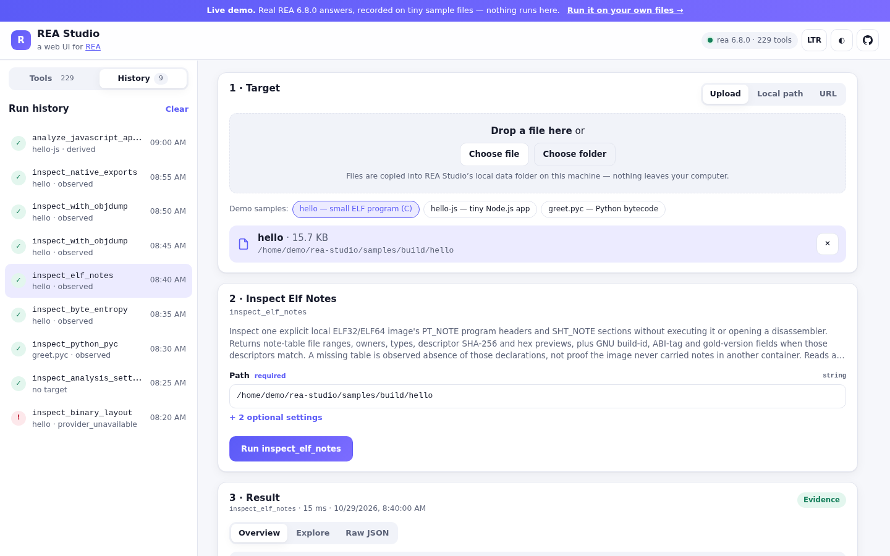
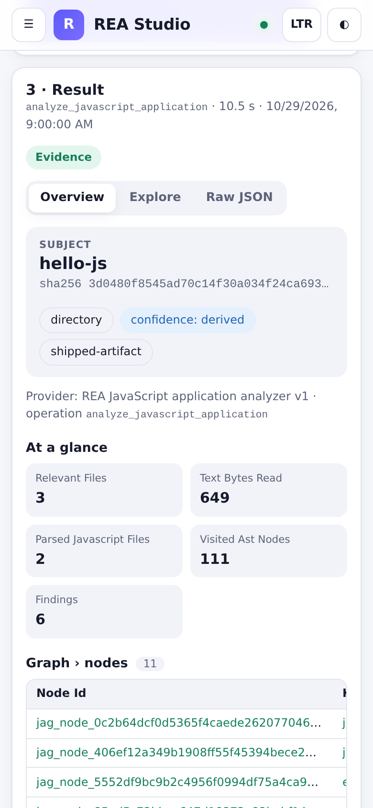
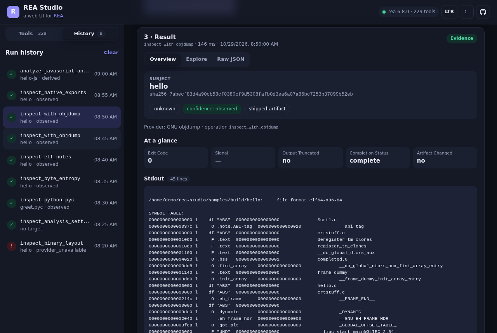

# REA Studio

**A local web UI for [REA — Reverse Engineer Anything](https://github.com/morluto/rea).**
Pick a file, folder or URL, choose one of REA's tools, and read the result as evidence — findings, coverage and limitations — instead of a wall of JSON.

**[Live demo →](https://rea-studio.sites.tab.bot/)** (static, with real REA answers recorded on tiny sample files)

> REA Studio is an independent community project. It is **not** an official REA project and is not affiliated with or endorsed by REA's authors.



<p align="center">
  
  &nbsp;
  
</p>

## What it does

- **Talks to REA over MCP.** REA Studio starts REA's MCP server (`rea mcp`) over stdio and asks it for its tools, so the UI always matches the REA version you have installed — all ~230 tools, grouped and searchable.
- **Forms from schemas.** Each tool's form is generated from the JSON Schema REA advertises: enums, numbers, booleans, lists and raw JSON for nested objects. Path fields fill in from your chosen target.
- **Targets.** Upload a file or a whole folder (it is copied into a local data folder), use an absolute path on your machine, or download a URL first.
- **Evidence view.** Subject, digest, format, REA's confidence and authority, coverage, findings/issues, tables for row data, tool output, and REA's own **limitations** and **unknowns** — shown up front, not buried. Errors show REA's remediation text.
- **Explore + raw JSON.** A collapsible tree for big results, and the raw MCP result with copy and download.
- **History** of runs (kept in `~/.rea-studio`), progress and cancel, **dark mode**, and an **RTL-safe** layout (logical CSS throughout; toggle LTR/RTL in the header).

## Quick start

You need Node.js (REA 6.8 asks for Node `^22.23.4`, `^24.22.1` or `>=26.12.1`).

```sh
# 1. Install REA (see https://github.com/morluto/rea for the full guide)
npx rea-agents setup          # registers REA with your agents
npm install --global rea-agents   # optional: puts `rea` on PATH so REA Studio starts faster

# 2. Run REA Studio
git clone https://github.com/theyishaik-lab/rea-studio.git
cd rea-studio
npm i && npm start
```

Open **http://127.0.0.1:4317**.

### How REA Studio finds REA

In this order:

1. `REA_BIN` — path to the `rea` executable (or to `rea-agents/scripts/rea.mjs`)
2. a `rea-agents` package installed in the folder you start REA Studio from
3. `rea` on your `PATH` (`npm install --global rea-agents`)
4. otherwise `npx -y rea-agents@latest mcp`

Native engines (Ghidra, Hopper, IDA, pwntools, Frida, adb …) are configured the way REA documents them; tools whose engine is missing return REA's own "provider unavailable" error with the fix, and REA Studio shows it. Static JavaScript, ELF/PE/Mach-O metadata, entropy, archives and Python bytecode work with no engine.

### Settings

| Variable | Default | |
|---|---|---|
| `REA_STUDIO_HOST` / `--host` | `127.0.0.1` | Interface to listen on. Read the security notes before changing it. |
| `REA_STUDIO_PORT` / `--port` | `4317` | |
| `REA_STUDIO_DATA_DIR` | `~/.rea-studio` | Run history and uploaded files. |
| `REA_STUDIO_MAX_UPLOAD_MB` | `512` | Per-file upload / download limit. |
| `REA_STUDIO_CALL_TIMEOUT_MS` | `1800000` | Per-call timeout (reset by REA progress). |
| `REA_STUDIO_TOKEN` | — | Require this bearer token on every API call. |
| `REA_STUDIO_ALLOWED_HOSTS` | — | Extra `host[:port]` names the UI may be reached under. |
| `REA_BIN` | — | See above. |

## Security notes — read before exposing it

REA Studio runs analysis tools **on files on the machine it runs on**, and some REA tools launch processes, attach debuggers or talk to devices. Treat it like a terminal.

- It listens on **127.0.0.1 only** by default.
- Requests must use a known `Host` (blocks DNS rebinding), cross-origin requests are refused, and every write needs a custom header a foreign web page cannot send.
- Uploads are stored under the data folder with sanitized names; nothing is sent anywhere else. REA itself reads targets as untrusted input — see REA's docs for what each tool executes.
- If you bind to another interface (`--host 0.0.0.0`), REA Studio **requires a token** (it generates one and prints the URL if you don't set `REA_STUDIO_TOKEN`). Even then, anyone with the token can run REA on your machine. Put it behind your own authentication/TLS, never on the open internet, and prefer an SSH tunnel: `ssh -L 4317:127.0.0.1:4317 yourhost`.
- Analyze only software you own or are authorized to examine. REA's [disclaimer](https://github.com/morluto/rea/blob/main/DISCLAIMER.md) applies.

## Development

```sh
npm run dev          # API + Vite dev server with hot reload on http://127.0.0.1:4317
npm test             # node --test: schema → form, result parsing, API + security checks (no REA needed)
npm run build:demo   # static demo build in dist-demo/ (no backend)
REA_BIN=$(which rea) npm run record-demo   # re-record the demo answers from samples/
```

Layout: `server/` (Express API + MCP client), `src/` (React + Vite UI), `src/demo/` (recorded catalog and runs for the demo), `samples/` (the tiny files the demo was recorded on).

## The demo

The demo at **[rea-studio.sites.tab.bot](https://rea-studio.sites.tab.bot/)** is the same UI built with `--mode demo`. Its tool list is REA 6.8.0's real catalog, and its results are REA's real answers, recorded with `npm run record-demo` on the files in `samples/` (a 15-line C program, a two-file Node app and a Python module). Paths in them were rewritten to `/home/demo/...`. Tools without a recording explain how to run them locally.

## License

MIT — see [LICENSE](LICENSE).

REA is © morluto and contributors, [MIT licensed](https://github.com/morluto/rea/blob/main/LICENSE). Tool names, descriptions and schemas shown in the demo come from REA. This project does not bundle or redistribute REA; it starts the copy you install.
